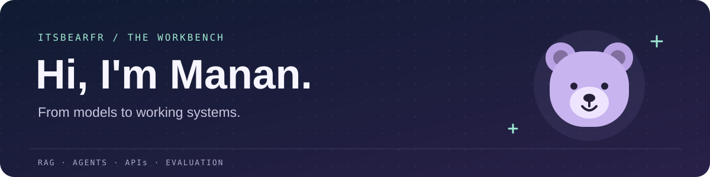

<p align="center">
  
</p>

<p align="center">
  <strong>Building toward AI/ML Platform Engineering</strong><br />
  Python · FastAPI · RAG · LangGraph · Agent Evaluation<br />
  CSE @ LNMIIT · Class of 2028
</p>

<p align="center">
  <a href="#the-workbench">Projects</a> &nbsp; / &nbsp;
  <a href="#my-main-stack">Stack</a> &nbsp; / &nbsp;
  <a href="#open-source">Open source</a> &nbsp; / &nbsp;
  <a href="#currently-exploring">Learning</a> &nbsp; / &nbsp;
  <a href="https://www.linkedin.com/in/manan-vaish-0ba187313/">LinkedIn</a> &nbsp; / &nbsp;
  <a href="mailto:vaishmanan13@gmail.com">Say hello</a>
</p>

---

### 🐻 Hey, I'm Manan Vaish

I'm a **B.Tech Computer Science student at The LNM Institute of Information Technology, Jaipur**, graduating in May 2028, working toward **AI/ML platform engineering**.

I'm most interested in the engineering between a model and a working product: **retrieval pipelines, agent orchestration, APIs, evaluation, CI/CD, and monitoring**. My projects explore source-verified legal summaries and multi-agent healthcare navigation, with tests and benchmarks to check what actually improves.

**Open to AI/ML and software engineering internships.** I also enjoy DSA, architecture, and high-level system design.

### My main stack

| Layer | What I focus on | Tools |
| --- | --- | --- |
| **Backend & APIs** | Typed interfaces, validation, persistence, and service logic | Python · FastAPI · Pydantic · SQLAlchemy · SQL |
| **RAG & agents** | Retrieval workflows, agent coordination, evidence grounding, and human approvals | LangChain · LangGraph · Fetch.ai uAgents |
| **Models & NLP** | Embeddings, rhetorical-role classification, and text summarisation | PyTorch · Hugging Face Transformers · InLegalBERT · scikit-learn |
| **Evaluation & reliability** | Regression tests, ROUGE/F1 benchmarks, agent evaluation, retries, and idempotency | pytest · NumPy · Pandas |
| **Platform tooling** | Developing my workflow for experiment tracking, CI/CD, deployment, and monitoring | MLflow · GitHub Actions · AWS EC2 · Git |

The projects below show my implementation work; platform tooling and system design are areas I'm continuing to deepen.

```text
Documents & data → Retrieval / models → Agent workflows → APIs
                          ↑                  ↑             ↑
                     Evaluation         Regression tests  Monitoring
```

### The workbench

<table>
  <tr>
    <td width="50%" valign="top">
      <h3>⚖️ <a href="https://github.com/itsbearfr/legal-judgment-summarizer">Legal Judgment Summarizer</a></h3>
      <p>Rhetorical-role classification and source-verified summaries for Indian judgments.</p>
      <p><strong>ROUGE-L: 21.98 → 30.23</strong> on 100 held-out IN-Abs cases; empty decision sections reduced from 45 to 13.</p>
      <p><code>InLegalBERT</code> <code>BiLSTM + CRF</code> <code>PyTorch</code></p>
    </td>
    <td width="50%" valign="top">
      <h3>🧭 <a href="https://github.com/itsbearfr/CareCompass_AI">CareCompass AI</a></h3>
      <p>Coordinated agents for hospital verification and insurer research, with evidence-grounded ranking and human-approved actions.</p>
      <p><strong>146 tests · 100 benchmark journeys · 0 duplicate writes.</strong></p>
      <p><code>Fetch.ai uAgents</code> <code>ASI:One</code> <code>Pydantic</code></p>
    </td>
  </tr>
  <tr>
    <td colspan="2" valign="top">
      <h3>🌍 <a href="https://github.com/itsbearfr/Earthquake_Relief_Centre">Earthquake Relief Centre</a></h3>
      <p>A relief-management app for tracking victims, shelters, and supplies. Compares multi-objective allocation strategies that balance coverage, cost, and response time.</p>
      <p><code>Flask</code> <code>MySQL</code> <code>MOEA/D</code> <code>NSGA-II</code> <code>SPEA2</code></p>
    </td>
  </tr>
</table>

### Open source

I contribute targeted fixes, performance improvements, and regression tests to Python and AI tooling.

**Merged upstream:** [sequential batch queries](https://github.com/SreejaPasula/flowmcp/pull/55) and [reusable prompt templates](https://github.com/SreejaPasula/flowmcp/pull/58).

**Submitted for review** — status checked 26 November 2026:

| Project | Contribution | Validation |
| --- | --- | --- |
| [KeyBERT #283](https://github.com/MaartenGr/KeyBERT/pull/283) | Compute Max Sum pairwise similarities only for shortlisted candidates | 41 focused tests; synthetic peak traced memory ~63 → 2 MiB |
| [LlamaIndex #24427](https://github.com/run-llama/llama_index/pull/24427) | Add filesystem support to XMLReader | 41 tests passed |
| [FastEmbed #903](https://github.com/qdrant/fastembed/pull/903) | Reject zero standard deviations during image normalisation | 31 targeted tests passed |
| [Textstat #229](https://github.com/textstat/textstat/pull/229) | Preserve Arabic diacritics when counting complex words | 486 tests passed, 3 skipped |
| [WordCloud #818](https://github.com/amueller/word_cloud/pull/818) | Preserve transparency in embedded SVG raster images | 79 tests passed |

These five PRs are awaiting maintainer review, not merged contributions. Each PR documents its checks and any testing limitations. Contributions were prepared with AI assistance and tested; implementation and validation details are in the linked PRs.

### Beyond the code

- **Data Analytics Intern · Rajasthan Asset Management Company** — May–July 2026. Explored financial datasets and prototyped reporting automation.
- **Head of Sponsorship · TEDxLNMIIT** — June 2025–present. Led sponsorship outreach, pitches, and sponsor relationships for TEDxLNMIIT 2025.

### Currently exploring

- **AI platforms:** experiment tracking, deployment workflows, CI/CD, and monitoring.
- **Reliable agents:** retrieval quality, agent evaluations, and source-grounded verification.
- **Systems:** data structures, algorithms, architecture, and high-level system design.

<details>
<summary>🧰 More of my toolkit</summary>

| Area | Toolkit |
| --- | --- |
| Languages | Python, C/C++, Java, SQL |
| AI & data | PyTorch, TensorFlow, scikit-learn, Hugging Face, Pandas, NumPy |
| Agents & retrieval | Fetch.ai uAgents, LangChain, LangGraph, RAG |
| Backend | FastAPI, Flask, Streamlit, Pydantic, SQLAlchemy, MySQL, SQLite |
| Evaluation | pytest, ROUGE/F1 benchmarking, agent and RAG evaluation |

</details>

<details>
<summary>📚 Learning foundations</summary>

Completed **Supervised Machine Learning: Regression and Classification** and **Advanced Learning Algorithms** from DeepLearning.AI and Stanford via Coursera (2024).

Building on data structures and algorithms, OOP, databases, operating systems, and computer networks.

</details>

---

<p align="center">
  Have an idea involving NLP, RAG, or agentic AI?<br />
  <a href="mailto:vaishmanan13@gmail.com"><strong>Let's build something useful.</strong></a>
</p>
